<picture>
  <source type="image/svg+xml" media="(prefers-reduced-motion: reduce) and (max-width: 600px) and (prefers-color-scheme: dark)" srcset="assets/hero-mobile-dark-still.svg">
  <source type="image/svg+xml" media="(prefers-reduced-motion: reduce) and (max-width: 600px)" srcset="assets/hero-mobile-light-still.svg">
  <source type="image/svg+xml" media="(prefers-reduced-motion: reduce) and (prefers-color-scheme: dark)" srcset="assets/hero-dark-still.svg">
  <source type="image/svg+xml" media="(prefers-reduced-motion: reduce)" srcset="assets/hero-light-still.svg">
  <source type="image/svg+xml" media="(max-width: 600px) and (prefers-color-scheme: dark)" srcset="assets/hero-mobile-dark.svg">
  <source type="image/svg+xml" media="(max-width: 600px)" srcset="assets/hero-mobile-light.svg">
  <source type="image/svg+xml" media="(prefers-color-scheme: dark)" srcset="assets/hero-dark.svg">
  <source type="image/svg+xml" srcset="assets/hero-light.svg">
  <source media="(max-width: 600px) and (prefers-color-scheme: dark)" srcset="assets/hero-mobile-dark.png">
  <source media="(max-width: 600px)" srcset="assets/hero-mobile-light.png">
  <source media="(prefers-color-scheme: dark)" srcset="assets/hero-dark.png">
  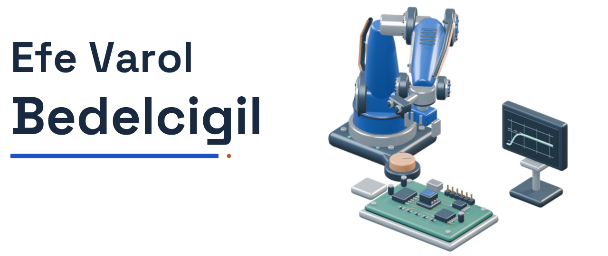
</picture>

<a href="https://github.com/efebedelcigil"><picture><source media="(prefers-color-scheme: dark)" srcset="assets/social-github-dark.svg"></picture></a> <a href="https://www.linkedin.com/in/efevarolbedelcigil/"><picture><source media="(prefers-color-scheme: dark)" srcset="assets/social-linkedin-dark.svg"></picture></a>

<a href="https://efebedelcigil.github.io/en/"><picture><source media="(max-width: 600px) and (prefers-color-scheme: dark)" srcset="assets/portfolio-mobile-dark.svg"><source media="(max-width: 600px)" srcset="assets/portfolio-mobile-light.svg"><source media="(prefers-color-scheme: dark)" srcset="assets/portfolio-dark.svg">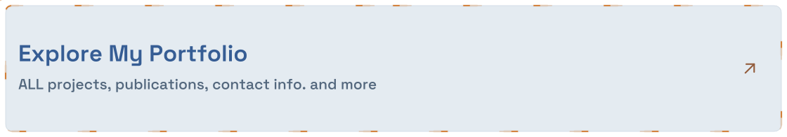</picture></a>

<picture><source media="(max-width: 600px) and (prefers-color-scheme: dark)" srcset="assets/focus-mobile-dark.svg"><source media="(max-width: 600px)" srcset="assets/focus-mobile-light.svg"><source media="(prefers-color-scheme: dark)" srcset="assets/focus-dark.svg">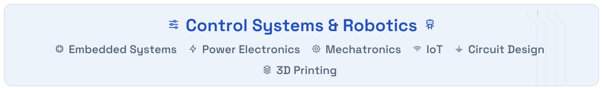</picture>

### Tools

<picture><source media="(max-width: 600px) and (prefers-color-scheme: dark)" srcset="assets/toolkit-mobile-dark.svg"><source media="(max-width: 600px)" srcset="assets/toolkit-mobile-light.svg"><source media="(prefers-color-scheme: dark)" srcset="assets/toolkit-dark.svg"></picture>

<picture><source media="(max-width: 600px) and (prefers-color-scheme: dark)" srcset="assets/learning-mobile-dark.svg"><source media="(max-width: 600px)" srcset="assets/learning-mobile-light.svg"><source media="(prefers-color-scheme: dark)" srcset="assets/learning-dark.svg"></picture>

<picture><source media="(max-width: 600px) and (prefers-color-scheme: dark)" srcset="assets/exploring-mobile-dark.svg"><source media="(max-width: 600px)" srcset="assets/exploring-mobile-light.svg"><source media="(prefers-color-scheme: dark)" srcset="assets/exploring-dark.svg">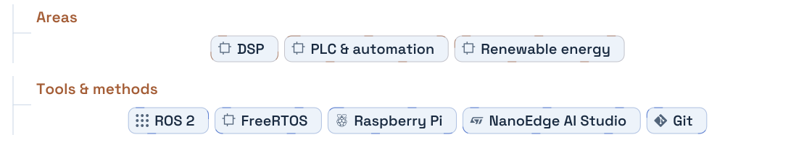</picture>

<picture><source media="(prefers-color-scheme: dark)" srcset="assets/contribution-dark.svg"></picture>

<picture><source media="(prefers-color-scheme: dark)" srcset="assets/profile-cards-dark.svg">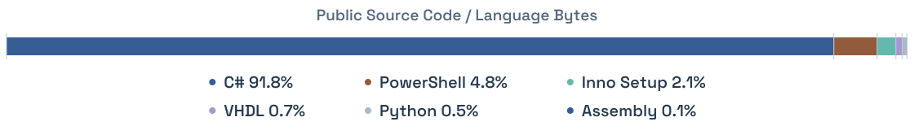</picture>

### Selected repositories

<a href="https://github.com/efebedelcigil/assembly-full-adder"><picture><source media="(prefers-color-scheme: dark)" srcset="assets/repo-assembly-full-adder-dark.svg">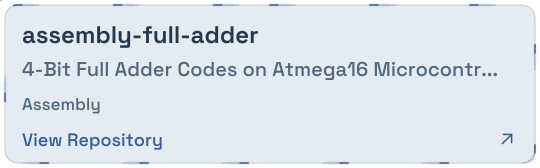</picture></a>

<a href="https://github.com/efebedelcigil/nextcalibur-control-center"><picture><source media="(prefers-color-scheme: dark)" srcset="assets/repo-nextcalibur-control-center-dark.svg">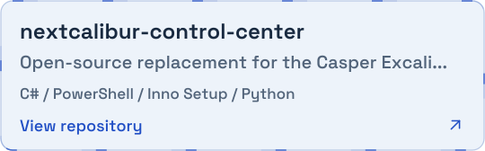</picture></a>

<a href="https://github.com/efebedelcigil/single-cycle-cpu"><picture><source media="(prefers-color-scheme: dark)" srcset="assets/repo-single-cycle-cpu-dark.svg">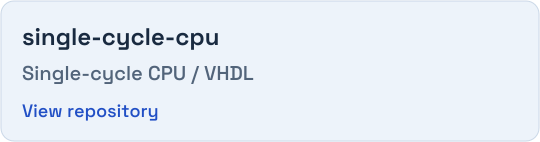</picture></a>

---

[Still version](docs/STATIC.md) · 
