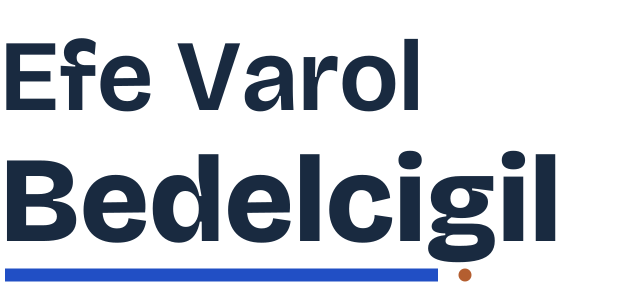
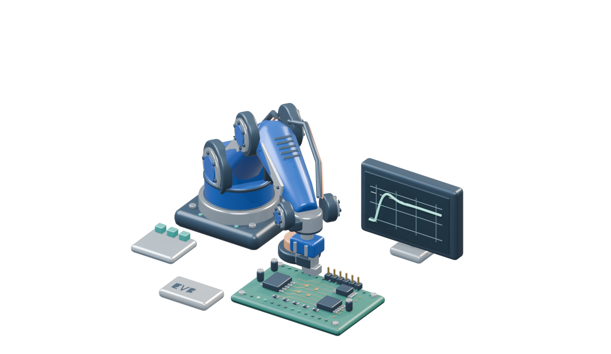

<picture>
  <source media="(max-width: 600px) and (prefers-color-scheme: dark)" srcset="../assets/identity-mobile-dark.svg">
  <source media="(max-width: 600px)" srcset="../assets/identity-mobile-light.svg">
  <source media="(prefers-color-scheme: dark)" srcset="../assets/identity-dark.svg">
  
</picture>

Final-year Electrical & Electronics Engineering student at **Ege University**.

[Portfolio](https://efebedelcigil.github.io/en/) · [LinkedIn](https://www.linkedin.com/in/efevarolbedelcigil/) · [Contact](https://efebedelcigil.github.io/en/contact/)

### Areas

**Control systems · Robotics**

Embedded systems · Power electronics · Mechatronics · IoT

Circuit design · 3D printing

### Tools

<picture>
  <source media="(max-width: 600px) and (prefers-color-scheme: dark)" srcset="../assets/toolkit-mobile-dark.svg">
  <source media="(max-width: 600px)" srcset="../assets/toolkit-mobile-light.svg">
  <source media="(prefers-color-scheme: dark)" srcset="../assets/toolkit-dark.svg">
  
</picture>

<picture>
  <source media="(max-width: 600px)" srcset="../assets/workbench-mobile.png">
  
</picture>

[Animated version](../README.md)

### In progress

**Areas** — Machine learning · Motor control · Sensing

**Tools** — Python · VHDL / Verilog · Gazebo · SolidWorks / Fusion

My graduation project explores TinyML for control systems.

<b>Interested in exploring</b>

**Areas** — DSP · PLC & automation · Renewable energy

**Tools** — ROS 2 · FreeRTOS · Raspberry Pi · NanoEdge AI Studio · Git

<b>Engineering work</b>

### Control & robotics

- [STM32 gimbal](https://efebedelcigil.github.io/portfolio/en/stm32-gimbal/)
- [Mavi İnci USV](https://efebedelcigil.github.io/portfolio/en/usv-mavi-inci/)

### Embedded & digital

- [Single-cycle CPU](https://github.com/efebedelcigil/single-cycle-cpu)
- [4-bit full adder](https://github.com/efebedelcigil/assembly-full-adder)

### Power electronics

- [Linear power supply](https://efebedelcigil.github.io/portfolio/en/linear-power-supply/)
- [DC-DC workshop](https://efebedelcigil.github.io/portfolio/en/dc-dc-converters-workshop/)

